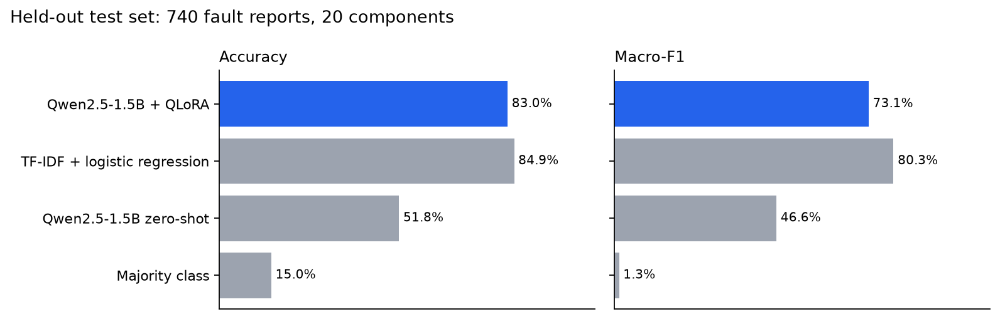
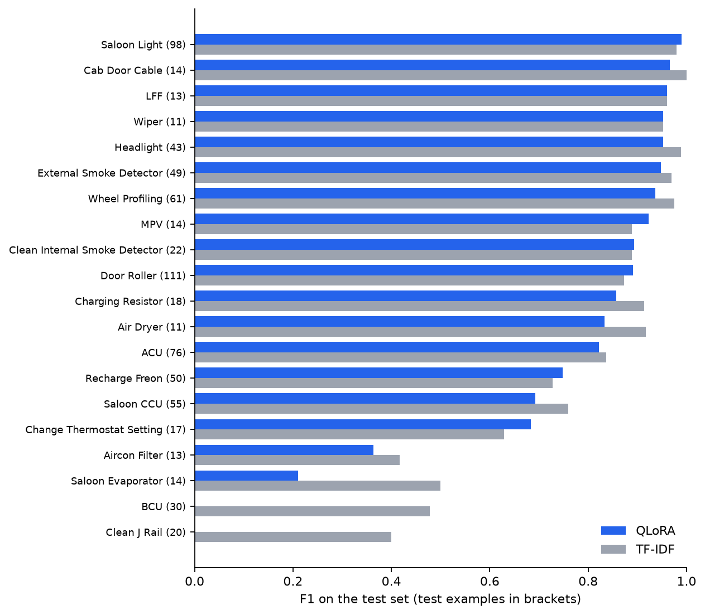
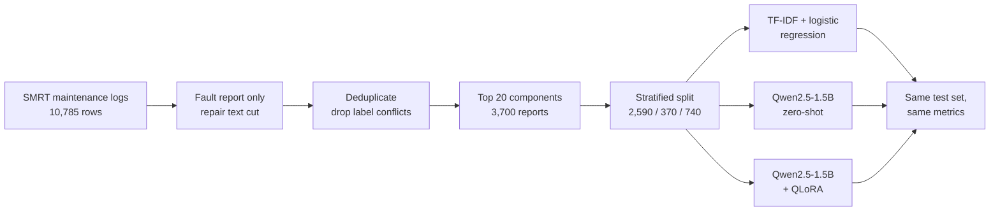

# Fine-tuning an LLM to triage train maintenance faults

**Given a technician's fault report from a metro train ("TIMS showed BCU brake fault at car 2530"), predict which of 20 components will need repair. QLoRA fine-tuning lifts Qwen2.5-1.5B-Instruct from 51.8% to 83.0% accuracy on 740 held-out real reports, and cuts off-list answers from 12.7% to 0.1%. A TF-IDF + logistic-regression baseline scores 84.9%: statistically a tie on accuracy (McNemar p = 0.15), and ahead on macro-F1 (0.80 vs. 0.73), mostly because the LLM never gets two ambiguous components right.** The experiment is built to answer whether the LLM is worth its GPU, not to make it look good.

[](https://github.com/dojedaro/qlora-maintenance-triage/actions/workflows/ci.yml)
[](https://colab.research.google.com/github/dojedaro/qlora-maintenance-triage/blob/main/notebooks/run_experiment.ipynb)



## Results

Held-out test set: 740 fault reports, 20 components, never seen in training or model selection.
95% confidence intervals from 2,000 bootstrap resamples.

| Model | Accuracy | 95% CI | Macro-F1 | Off-list answers |
|---|---|---|---|---|
| Majority class | 15.0% | | 0.013 | – |
| Qwen2.5-1.5B-Instruct, zero-shot | 51.8% | 48.2–55.4 | 0.466 | 12.7% |
| **Qwen2.5-1.5B-Instruct + QLoRA** | **83.0%** | 80.3–85.7 | 0.731 | 0.1% |
| TF-IDF + logistic regression | 84.9% | 82.2–87.6 | 0.803 | – |

- **Fine-tuning is what makes the LLM usable.** Zero-shot, the model invents parts ("BCD",
  "Front DT- 3603'A4' door") or answers half a name in 12.7% of reports; after QLoRA it answers
  with an exact component name 99.9% of the time and gains 31 points of accuracy.
- **It ties the classical baseline on accuracy.** The two give different answers on 95 reports;
  exactly one of them is right on 82 (QLoRA on 34, TF-IDF on 48). An exact McNemar test on those
  gives p = 0.15, so neither is better on accuracy at this sample size.
- **It trails on macro-F1** (every component weighted equally): 0.73 vs. 0.80. Paired over the same
  bootstrap resamples, the difference is −0.072 (95% CI −0.108 to −0.034), so this gap is real.
  The per-component chart shows it comes mostly from two components.
- **Zero-shot here means one plain prompt** listing the 20 components. A better prompt, or few-shot
  examples retrieved from past reports, would narrow the gap to the fine-tuned model; see
  Limitations.



**Error analysis.** The fine-tuned model never gets two components right (it predicts each one once, wrongly):

- *BCU* (30 test reports): a "BCU brake fault" on the train's display is usually fixed by replacing
  the ACU, so the model answers ACU for 26 of them. TF-IDF, trained with balanced class weights,
  gets 11 right.
- *Clean J Rail* (20 reports): "doors not proven closed" is usually a door roller and sometimes a
  dirty J-rail. The model always answers Door Roller.

The labels record the **repair that was made**, and one symptom can have several repairs. The LLM
learns the most common repair for each symptom; the class-weighted baseline hedges toward rarer
ones. In production this argues for showing a technician the top 2–3 candidates rather than one
answer.

## Follow-up: top-3 suggestions, retrieval vs. fine-tuning, class balance, a second seed

Same 740 test reports ([`extensions.py`](src/maintriage/extensions.py), results in
[`results/extensions/`](results/extensions/)). LLMs are scored here by **ranking** all 20 components by
the probability of generating each name, which gives top-k suggestions and an answer that can never
fall outside the list ([`rank_labels`](src/maintriage/llm.py), tested against a full forward pass).

| Approach | Top-1 | Top-3 | Macro-F1 |
|---|---|---|---|
| TF-IDF + logistic regression | 84.9% | 97.2% | 0.80 |
| Vote of the 5 most similar past reports | 78.8% | – | 0.73 |
| Qwen2.5-1.5B zero-shot | 57.6% | 70.8% | 0.48 |
| Qwen2.5-1.5B + 5 retrieved past reports in the prompt | 69.9% | 87.2% | 0.66 |
| Qwen2.5-1.5B + QLoRA, second seed (43) | 82.4% | **97.4%** | 0.74 |
| Qwen2.5-1.5B + QLoRA, rare components oversampled | 83.8% | 97.2% | 0.75 |

- **Top-3 is what a technician would use, and it is right 97% of the time** for both the fine-tuned
  LLM and TF-IDF, against 83–85% for a single answer.
- **Fine-tuning beats retrieval-augmented prompting by 14 points** (83.8% vs. 69.9% top-1). Showing
  the base model five similar past reports with their repairs helps a lot over zero-shot (+12 points),
  but it does not teach the model this fleet's repair habits the way 2,590 training examples do.
- **The result reproduces:** a second training seed gives 81.6% generated accuracy (82.4% ranked)
  against 83.0% for the first.
- **Class balancing barely helps,** which confirms the error analysis. Oversampling rare components
  to the median count lifts macro-F1 from 0.73–0.74 to 0.75, but BCU stays at 1 of 30 (the model still
  answers ACU, the usual repair) and Clean J Rail rises to 5 of 20, close to the 4 of 20 the unbalanced
  second seed already got. The ambiguity is in the labels, not in a training imbalance.

## Is the task leaking the answer?

The raw logs concatenate the fault report with the corrective action, which usually names the
replaced part. Training on that would turn triage into reading the answer. So:

- **Only the fault report is used.** [`extract_fault`](src/maintriage/data.py) keeps the fault text
  and cuts everything from the first completed-repair phrase ("replaced", "rectified", "done by",
  "tested ok", …). Requests such as "to replace door roller" stay: that is the technician's
  diagnosis, available at triage time.
- **Duplicates are removed before splitting.** The published train and test splits share hundreds of
  identical rows. Reports that differ only in train or car number count as duplicates, and reports
  filed under conflicting components are dropped rather than resolved arbitrarily. That removes a
  lot: 2,521 of 10,785 rows sit in label conflicts. Most are generic reports whose repair varies
  ("TC reported air-con fault. Unable to …" alone appears 124 times under different components) or
  reports that the repair-text cut leaves too vague ("During DT check")
  ([`data_audit.json`](results/data_audit.json), from `python -m maintriage.data`). Dropping them
  makes the task cleaner but easier than triaging every incoming report.
- **Checked, not assumed** ([`analysis.py`](src/maintriage/analysis.py)):
  - Only 22% of test reports mention their own component's name, and a keyword baseline that
    predicts the named component scores 36.5%. On the 574 reports that do not name it, accuracy
    barely moves (QLoRA 81.2%, TF-IDF 82.2%).
  - 25% of test reports open with the same six words as some training report, mostly templates
    such as "TC reported TIMS showed …". On the 553 test reports with an opening never seen in
    training, accuracy holds (QLoRA 81.6%, TF-IDF 84.5%), so the models are not matching templates.

## How it works



- **Same prompt for both LLM runs** ([`prompts.py`](src/maintriage/prompts.py)): the 20 component
  names and the fault report. A strict parser maps the answer to a component or marks it invalid;
  there is no fuzzy matching that could hide a made-up answer (strict exact-match accuracy is
  reported too: 83.0% for QLoRA).
- **QLoRA** ([`llm.py`](src/maintriage/llm.py)): base model frozen in 4-bit NF4 with double
  quantization; LoRA adapters (r = 16, α = 32) on every linear layer, 18.5M trainable parameters
  (1.2% of the model); loss only on the answer tokens; 2 epochs, cosine schedule, learning rate
  2e-4. Unit tests check the loss mask and that training prompts match generation prompts token
  for token.
- **Cost on a free Colab T4:** 20 minutes of training and 7.6 GB peak GPU memory. The TF-IDF
  baseline trains in about 5 seconds on a laptop CPU.

## Run it

```bash
pip install -e ".[dev]"
python -m maintriage.run --out results --cpu-only   # data pipeline + classical baselines, CPU
pytest
```

The full experiment needs a CUDA GPU: open the notebook with the Colab badge above (T4 runtime),
or run `pip install -e ".[gpu]" && python -m maintriage.run --out results` on a GPU machine. Then:

```bash
python -m maintriage.analysis --results results   # CIs, McNemar, paired macro-F1, leakage checks
python -m maintriage.report --results results     # charts
```

The follow-up experiments run with `python -m maintriage.extensions --out results/extensions`
(GPU, about two hours on a T4; notebook: `notebooks/run_extensions.ipynb`).

`results/` holds the committed run: metrics with the exact library versions, per-class scores,
every test prediction with the raw model output, the analysis and the data audit.

**Provenance.** The GPU run used commit `03f91e0` on a Colab T4 (Python 3.13, torch 2.14,
transformers 5.22, peft 0.21, bitsandbytes 0.50; all in `metrics.json`). A later commit fixed how
`top_components` breaks ties in component counts, which pandas 2 and 3 order differently; the
current code reproduces the run's test set exactly (same 740 reports, identical TF-IDF
predictions), and `analysis.py` refuses to run if the split ever stops matching the predictions.
Dependencies are lower-bounded in `pyproject.toml`; the versions above are the tested set.

## Limitations and next steps

- **Two seeds, one model size.** Next: Qwen2.5-3B/7B to see whether scale closes the macro-F1 gap.
- **Closed label set.** Only the 20 most frequent components (59% of unique reports) are in scope, and
  there is no "other" answer. A production version needs an abstain option, e.g. when the top
  component's ranked probability is low.
- **The labels are repairs, not causes.** Some symptoms map to several valid repairs; neither class
  balancing nor more examples of the same reports resolves that. The repair notes cut from the input,
  or equipment sensor data, are what could.

## Data

[SMRT Maintenance Logs](https://huggingface.co/datasets/ASNIJKDNI/SMRT-Maintenance-Logs) (MIT):
about 10,000 maintenance records from Singapore's SMRT trains, each labeled with the component that
was repaired. The data is downloaded at run time and not redistributed here; the committed
predictions file contains only the fault-report text used as model input, which refers to staff by
role or station code, not by name.

## Stack

Python, PyTorch, Hugging Face Transformers, PEFT, bitsandbytes, Datasets, scikit-learn, SciPy,
Matplotlib; pytest and ruff in CI.

## License

MIT
