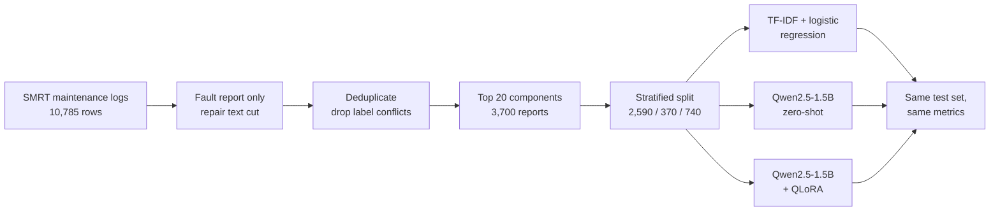

# Fine-tuning an LLM to triage train maintenance faults

**Given a technician's fault report from a metro train ("TIMS showed BCU brake fault at car 2530"), predict which of 20 components will need repair. QLoRA fine-tuning lifts Qwen2.5-1.5B-Instruct from 51.8% to 83.0% accuracy on 740 held-out real reports, and cuts off-list answers from 12.7% to 0.1%. A TF-IDF + logistic-regression baseline scores 84.9%: statistically a tie on accuracy (McNemar p = 0.15), and better on rare components.** The experiment is built to answer whether the LLM is worth its GPU, not to make it look good.

[](https://github.com/dojedaro/qlora-maintenance-triage/actions/workflows/ci.yml)
[](https://colab.research.google.com/github/dojedaro/qlora-maintenance-triage/blob/main/notebooks/run_experiment.ipynb)


## Results

Held-out test set: 740 fault reports, 20 components, never seen in training or model selection.
95% confidence intervals from 2,000 bootstrap resamples.

| Model | Accuracy | 95% CI | Macro-F1 | Off-list answers |
|---|---|---|---|---|
| Majority class | 15.0% | | 0.013 | – |
| Qwen2.5-1.5B-Instruct, zero-shot | 51.8% | 48.2–55.4 | 0.466 | 12.7% |
| **Qwen2.5-1.5B-Instruct + QLoRA** | **83.0%** | 80.3–85.7 | 0.731 | 0.1% |
| TF-IDF + logistic regression | 84.9% | 82.2–87.6 | 0.803 | – |

- **Fine-tuning is what makes the LLM usable.** Zero-shot, the model invents parts ("BCD",
  "Front DT- 3603 'A4' door") or answers half a name in 12.7% of reports; after QLoRA it answers
  with an exact component name 99.9% of the time and gains 31 points of accuracy.
- **It ties the classical baseline on accuracy.** The two disagree on 82 reports: QLoRA alone is
  right on 34, TF-IDF alone on 48. An exact McNemar test gives p = 0.15, so neither is better on
  accuracy at this sample size.
- **It loses on rare components.** Macro-F1 (every component weighted equally) is 0.73 vs. 0.80.
  The per-component chart below shows why.


**Error analysis.** The fine-tuned model never predicts two components:

- *BCU* (30 test reports): a "BCU brake fault" on the train's display is usually fixed by replacing
  the ACU, so the model answers ACU for 26 of them. TF-IDF, trained with balanced class weights,
  gets 11 right.
- *Clean J Rail* (20 reports): "doors not proven closed" is usually a door roller and sometimes a
  dirty J-rail. The model always answers Door Roller.

The labels record the **repair that was made**, and one symptom can have several repairs. The LLM
learns the most common repair for each symptom; the class-weighted baseline hedges toward rarer
ones. In production this argues for showing a technician the top 2–3 candidates rather than one
answer.

## Is the task leaking the answer?

The raw logs concatenate the fault report with the corrective action, which usually names the
replaced part. Training on that would turn triage into reading the answer. So:

- **Only the fault report is used.** [`extract_fault`](src/maintriage/data.py) keeps the fault text
  and cuts everything from the first completed-repair phrase ("replaced", "rectified", "done by",
  "tested ok", …). Requests such as "to replace door roller" stay: that is the technician's
  diagnosis, available at triage time.
- **Duplicates are removed before splitting.** The published train and test splits share hundreds of
  identical rows. Reports that differ only in train or car number count as duplicates, and reports
  filed under conflicting components are dropped rather than resolved arbitrarily.
- **Checked, not assumed** ([`analysis.py`](src/maintriage/analysis.py)): only 22% of test reports
  mention their own component's name; a keyword baseline that predicts the named component scores
  36.5%; on the 574 reports that do not name it, accuracy barely moves (QLoRA 81.2%, TF-IDF 82.2%).

## How it works



- **Same prompt for both LLM runs** ([`prompts.py`](src/maintriage/prompts.py)): the 20 component
  names and the fault report. A strict parser maps the answer to a component or marks it invalid;
  there is no fuzzy matching that could hide a made-up answer (strict exact-match accuracy is
  reported too: 83.0% for QLoRA).
- **QLoRA** ([`llm.py`](src/maintriage/llm.py)): base model frozen in 4-bit NF4 with double
  quantization; LoRA adapters (r = 16, α = 32) on every linear layer, 18.5M trainable parameters
  (1.2% of the model); loss only on the answer tokens; 2 epochs, cosine schedule, learning rate
  2e-4. Unit tests check the loss mask and that training prompts match generation prompts token
  for token.
- **Cost on a free Colab T4:** 20 minutes of training and 7.6 GB peak GPU memory. The TF-IDF
  baseline trains in about 5 seconds on a laptop CPU.

## Run it

```bash
pip install -e ".[dev]"
python -m maintriage.run --out results --cpu-only   # data pipeline + classical baselines, CPU
pytest                                               # 30 tests
```

The full experiment needs a CUDA GPU: open the notebook with the Colab badge above (T4 runtime),
or run `pip install -e ".[gpu]" && python -m maintriage.run --out results` on a GPU machine. Then:

```bash
python -m maintriage.analysis --results results   # confidence intervals, McNemar, leakage checks
python -m maintriage.report --results results     # charts
```

`results/` holds the committed run: metrics with the exact library versions, per-class scores,
every test prediction with the raw model output, and the analysis.

## Limitations and next steps

- **One seed, one model size.** The bootstrap intervals cover test-set sampling, not training
  variance. Next: 3 seeds, and Qwen2.5-3B/7B to see whether scale closes the macro-F1 gap.
- **Closed label set.** Only the 20 most frequent components (59% of unique reports) are in scope, and
  there is no "other" answer. A production version needs an abstain option.
- **Class imbalance is unaddressed for the LLM.** The baseline uses balanced class weights; the LLM
  does not. Weighted loss or oversampling rare components is the obvious next experiment.
- **Retrieval baseline not yet run.** A few-shot prompt with the most similar past reports
  (retrieval over the training set) would show whether fine-tuning beats retrieval for this task.

## Data

[SMRT Maintenance Logs](https://huggingface.co/datasets/ASNIJKDNI/SMRT-Maintenance-Logs) (MIT):
about 10,000 maintenance records from Singapore's SMRT trains, each labeled with the component that
was repaired. The data is downloaded at run time and not redistributed here; the committed
predictions file contains only the fault-report text used as model input, which refers to staff by
role or station code, not by name.

## Stack

Python, PyTorch, Hugging Face Transformers, PEFT, bitsandbytes, Datasets, scikit-learn, SciPy,
Matplotlib; pytest and ruff in CI.

## License

MIT
